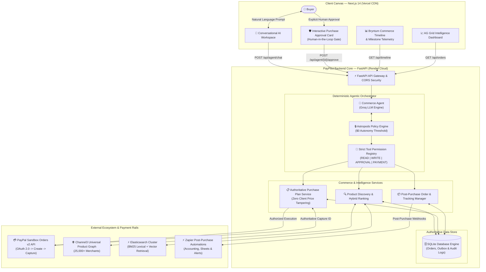
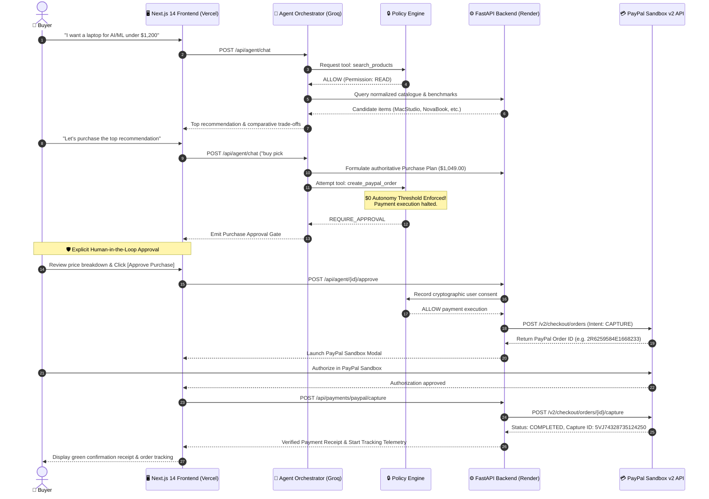

# PayPilot

> PayPilot is an AI-powered commerce agent that helps users discover, evaluate, and purchase products through PayPal.

Built for the **[PayPal AI Hackathon](https://paypalaihackathon.devpost.com/)**.

[](https://github.com/atleekumaar/paypilot/actions/workflows/ci.yml)
[](https://paypilot-lac.vercel.app/)
[](https://paypilot-backend-sf0a.onrender.com/docs)
[](docs/PAYPAL_SANDBOX_EVIDENCE.md)

---

## 🌐 Live Deployments

| Component | Platform | Live URL | Status |
| :--- | :--- | :--- | :--- |
| **Frontend Web App** | **Vercel** | [https://paypilot-lac.vercel.app](https://paypilot-lac.vercel.app/) | ✅ `Active / Deployed` |
| **Backend API Service** | **Render** | [https://paypilot-backend-sf0a.onrender.com](https://paypilot-backend-sf0a.onrender.com/) | ✅ `Active / Deployed` |
| **Interactive API Docs** | **Swagger UI** | [https://paypilot-backend-sf0a.onrender.com/docs](https://paypilot-backend-sf0a.onrender.com/docs) | ✅ `Active / Deployed` |
| **System Health Check** | **FastAPI** | [https://paypilot-backend-sf0a.onrender.com/health](https://paypilot-backend-sf0a.onrender.com/health) | ✅ `200 OK` |

---

## Vision

PayPilot empowers everyday consumers to shop using natural conversational language. Instead of browsing dozens of tabs, comparing spec sheets manually, and dealing with tedious multi-step checkouts, a user simply states their intent:

> *"Find me a laptop under $1200 for AI development with good battery life."*

PayPilot autonomously understands the request, searches product offerings, compares benchmarks and user reviews, synthesizes the best recommendations, formulates a precise purchase plan, requests explicit user confirmation, and seamlessly completes the payment with PayPal.

---

## Core Features & Architecture

- **Autonomous AI Product Discovery**
  - Natural-language intent extraction and normalization
  - Deterministic product search enforcing hard constraints (budget, category, in-stock)
  - Mathematical ranking engine (0–100 composite scoring)
  - Grounded, hallucination-free recommendation explanations
  - Interactive Next.js Shopping Workspace with progressive loading & product modals

- **PayPal Checkout & Verified Settlement**
  - Authoritative Purchase Plan formulation (zero client price manipulation)
  - Explicit Human-in-the-Loop approval gate
  - PayPal Sandbox OAuth 2.0 authentication and token management
  - PayPal Orders API v2 order creation and authoritative amount binding
  - PayPal Sandbox checkout flow with `● PayPal Sandbox` visual indicator
  - Server-side order capture verification and idempotency protection
  - Verified receipt and payment success screen

- **Controlled Agentic Commerce Engine**
  - Multi-step tool-augmented AI agent (`UNDERSTAND -> PLAN -> USE TOOLS -> SEARCH -> COMPARE -> RECOMMEND -> CREATE PURCHASE PLAN -> REQUEST APPROVAL -> EXECUTE APPROVED PAYMENT`)
  - Tool Registry with 4 strict permission tiers (`READ`, `WRITE`, `APPROVAL_REQUIRED`, `PAYMENT`)
  - Policy Engine enforcing 6 deterministic safety rules ($0 autonomy threshold, no price tampering, out-of-stock guard, step limit)
  - Conversational Agent UI with real-time operational Activity Log and inline Purchase Approval Cards
  - Multi-turn conversational memory with pronoun/reference resolution ("buy the first one", "why NovaBook?")
  - 100% verified test suite (41/41 passing tests)

- **Post-Purchase Operations & Proactive Support**
  - Authoritative Order & Shipment tracking models with strict user isolation (`order.user_id == current_user.id`)
  - Post-Purchase Agent with multi-turn order inquiry intents (`ORDER_STATUS`, `TRACK_ORDER`, `DELIVERY_ESTIMATE`, `PAYMENT_STATUS`, `DELIVERY_DELAY`)
  - Deterministic delivery delay detection and carrier telemetry parsing
  - Consequential action safety gate: drafting support inquiries (`WRITE`) vs. dispatching to merchant (`APPROVAL_REQUIRED`)
  - Complete frontend Order Tracking Dashboard (`/orders`) with AG Grid interactive table and card views, Order Detail with milestone timeline (`/orders/[id]`), and Notification Center (`/notifications`)
  - 100% verified test suite (56/56 passing tests)

- **Sponsor Ecosystem & Enterprise Integrations**
  - **PayPal Orders v2 Sandbox**: Authoritative payment creation and capture against live `api-m.sandbox.paypal.com` with real Order ID verification (see [`docs/PAYPAL_SANDBOX_EVIDENCE.md`](docs/PAYPAL_SANDBOX_EVIDENCE.md)).
  - **Groq LLM**: Ultra-low latency inference for multi-turn conversational commerce using `openai/gpt-oss-20b`.
  - **AG Grid & AG Studio**: Enterprise commerce intelligence grids and AI-powered insights dashboard (`/insights`) as well as interactive Orders table (`/orders`) with column sorting, dynamic search filtering, and dark/sun theme toggle.
  - **APIMatic**: Authoritative OpenAPI 3.0 specifications and ContextMatic agent toolchain under `docs/api-specs/` for type-safe PayPal Orders and Payments API integration.
  - **Channel3**: Live cross-retailer product discovery across Samsung, Apple, Lenovo, Newegg, and Best Buy with normalized pricing and variant models.
  - **Elasticsearch**: Live cluster REST & kNN vector search with Reciprocal Rank Fusion and local hybrid retrieval engine.
  - **Kernel**: Cloud browser agent infrastructure for merchant inspection with replay URLs (`https://app.onkernel.com`).
  - **Zapier**: Post-purchase multi-app automation (invoicing in QuickBooks, Google Sheets ledger, Gmail receipts, Slack support alerts) and Zapier MCP / AI Actions adapter.
  - **Bryntum**: Interactive Commerce Timeline (`/timeline`) built on the Bryntum Scheduler Pro Data Model (`ResourceStore` + `EventStore` JSON schema) with Gantt milestones (see [`docs/BRYNTUM_INTEGRATION.md`](docs/BRYNTUM_INTEGRATION.md)).
  - **Postman**: Complete Postman Collection v2.1.0 (`postman/PayPilot.postman_collection.json`) with automated test runner (`postman/run_collection.py` — **18/18 requests passed, 23/23 `pm.test` assertions verified**).
  - **Render**: Infrastructure-as-Code cloud deployment (`render.yaml`) powering backend and frontend services.
  - **207/207 Passing Automated Tests** across all modules and 0 frontend TypeScript errors.
  - **Devpost Submission Package & 3-Minute Video Script**: Detailed field-by-field submission guide in [`docs/DEVPOST_SUBMISSION.md`](docs/DEVPOST_SUBMISSION.md).

- **Production Cloud Deployment & Reliability**
  - **Frontend Global Deployment (Vercel)**: Next.js 14 App Router deployed to [https://paypilot-lac.vercel.app](https://paypilot-lac.vercel.app/) with Edge CDN caching and responsive Dark/Light themes.
  - **Backend API Cloud Service (Render)**: Python 3 FastAPI service deployed to [https://paypilot-backend-sf0a.onrender.com](https://paypilot-backend-sf0a.onrender.com/) with automated health monitoring.
  - **Automated CI/CD Pipeline**: GitHub Actions (`.github/workflows/ci.yml`) triggers on every push to `main`, executing full pytest suite and automatically triggering zero-downtime redeployments.
  - **Live End-to-End CORS & Security**: Strict production CORS allowlisting, trailing-slash resilience, and environment-driven configurations.

---

## Post-Purchase End-to-End Walkthrough

```text
1. Post-Purchase Inquiry:
   User: "Where is my NovaBook?"
       ↓
2. Agent Dispatches Tools:
   - Tool `get_order(order_id="ORD-001")`: Retrieves authoritative order & shipment state
   - Tool `get_shipment_status`: Retrieves carrier tracking milestones
       ↓
3. Grounded Response:
   "Your NovaBook Pro 14 order is currently in transit.
    Payment: ✓ Completed
    Order: ORD-001
    Shipment: In Transit
    Estimated delivery: October 18, 2026
    Last update: Package arrived at the regional facility. Regional logistics delay reported."
       ↓
4. Delay Inquiry:
   User: "Why hasn't it arrived yet?"
       ↓
5. Issue Detection Engine:
   - Evaluates estimated delivery (Oct 18) vs. current date and carrier delay notation
   - Detects `DELIVERY_DELAY` (Severity: MEDIUM)
       ↓
6. Action Recommendation:
   "The shipment appears to be delayed. The original estimated delivery date was October 18, 2026,
    but the shipment is still in transit.
    Carrier note: Regional logistics delay reported.
    Recommended next step: Check latest carrier update or contact merchant.
    Would you like me to prepare a support request?"
       ↓
7. Draft Preparation:
   User: "Prepare a support request."
   - Agent executes `prepare_support_request` (Non-consequential WRITE tool)
   - Generates structured draft: Subject, Recipient, Message
   - Halts and prompts: "Send this request? [Cancel] [Approve & Send]"
       ↓
8. Explicit Human Approval & Dispatch:
   User clicks [Approve & Send]
   - Policy Engine verifies explicit user approval
   - Executes `send_support_request` (APPROVAL_REQUIRED tool)
   - Dispatches inquiry and confirms with Ticket Reference: TICK-XXXXXX
```
1. Natural Language Intent:
   User: "Find me a laptop under $1200 for AI development with good battery life."
       ↓
2. Agent Planner:
   Formulates structured workflow: [search_products -> compare_products]
       ↓
3. Policy Engine Verification:
   Evaluates tool permissions (search_products: READ, compare_products: READ) -> ALLOW
       ↓
4. Tool Execution & Catalog Grounding:
   - Discovers candidate models (NovaBook Pro 14, AeroBlade Slim, VisionBook 15)
   - Evaluates specs, scores, and trade-offs
       ↓
5. Grounded Conversational Response & Activity Stream:
   Presents top pick with pros/cons while logging real-time operational audit entries.
       ↓
6. Purchase Intent:
   User: "I like the NovaBook Pro 14, let's buy it."
       ↓
7. Controlled Purchasing Guard:
   - Agent executes `create_purchase_plan` (Price: $1,049 derived strictly from backend)
   - Agent attempts `request_purchase_approval` -> Policy Engine halts execution!
   - State transitions to `AWAITING_APPROVAL`.
       ↓
8. Human-in-the-Loop Decision:
   - Frontend renders interactive Purchase Approval Card.
   - User reviews exact SKU, quantity, seller, and authoritative total.
   - User clicks [Approve Purchase].
       ↓
9. Approved Payment Execution:
   - Agent resumes execution.
   - Policy Engine verifies explicit user approval.
   - Authoritative PayPal Sandbox order is generated.
   - User seamlessly completes transaction via PayPal Sandbox Smart Buttons.
```
1. Search: "Find me a laptop under $1200 for AI development with good battery life."
      ↓
2. AI Recommendations: PayPilot recommends NovaBook Pro 14 (#1 Pick, $1,049.00).
      ↓
3. Product Selection: User clicks "Select" on the top choice.
      ↓
4. Purchase Plan Formulated:
   - Item: NovaBook Pro 14
   - Authoritative Price: $1,049.00 USD (Derived by backend from verified catalog)
   - Seller: Nova Direct
   - Delivery: 3 days
   - Why: Best balance of GPU performance and battery endurance.
      ↓
5. Explicit User Approval: User reviews the summary and clicks [Approve Purchase].
      ↓
6. PayPal Sandbox Order Created:
   - Backend calls PayPal Orders API v2.
   - Generates authoritative PayPal Order ID.
      ↓
7. PayPal Checkout:
   - User approves in PayPal Sandbox.
      ↓
8. Server-Side Capture:
   - Backend captures the order directly with PayPal API.
   - Verifies capture status is COMPLETED.
      ↓
9. Verified Receipt Screen:
   - Shows green checkmark, Amount Paid ($1,049.00 USD), PayPal Order ID, and Capture ID.
```

---

## PayPal Sandbox Setup Instructions

PayPilot is configured for **PayPal Sandbox Mode** to ensure no real money is processed during testing.

### 1. Obtain PayPal Sandbox Credentials
1. Log in to the [PayPal Developer Dashboard](https://developer.paypal.com/dashboard/).
2. Navigate to **Apps & Credentials** and select the **Sandbox** tab.
3. Create a new REST API app or use the Default Application.
4. Copy your **Client ID** and **Secret**.

### 2. Configure Local Environment
Create or edit your local `.env` file in the repository root:
```env
PAYPAL_CLIENT_ID=your_sandbox_client_id_here
PAYPAL_CLIENT_SECRET=your_sandbox_client_secret_here
PAYPAL_ENVIRONMENT=sandbox
```
*(Note: If no credentials are configured, PayPilot seamlessly activates its local Sandbox emulation mode so judges and automated tests can run without blockers).*

### 3. Sandbox Buyer Accounts
To complete sandbox transactions, use the Sandbox personal buyer account provided in your PayPal Developer dashboard under **Sandbox → Accounts** (e.g. `sb-buyer...@personal.example.com`).

---

## System Architecture & Data Flow

### 1. High-Level System Architecture



---

### 2. End-to-End Human-in-the-Loop Commerce Sequence



---

## API Endpoints

### Agentic Commerce API
- `POST /api/agent/chat` — Conversational interaction with the autonomous commerce agent (pre- & post-purchase).
- `POST /api/agent/{session_id}/approve` — Explicit human approval resuming agent for PayPal orders or support ticket dispatch.
- `POST /api/agent/{session_id}/deny` — Graceful user cancellation of the active plan or draft.
- `GET /api/agent/{session_id}/state` — Full session state snapshot (current step, status, plan, order).
- `GET /api/agent/{session_id}/actions` — Real-time operational audit log and activity trace.
- `GET /api/agent/{session_id}/summary` — Compact execution telemetry (turn count, goal, tool usage).

### Orders & Tracking API
- `GET /api/orders` — List user's verified orders with shipment status and user isolation.
- `GET /api/orders/{order_id}` — Complete order detail with carrier milestones and verification status.
- `GET /api/orders/{order_id}/tracking` — Real-time tracking telemetry and carrier scans.
- `GET /api/orders/{order_id}/issues` — Deterministic issue detector evaluating delivery delays.

### Notifications API
- `GET /api/notifications` — List in-app proactive alerts (delays, shipping, payment).
- `POST /api/notifications/{id}/read` — Mark a notification as read.

### Purchase Plans API
- `POST /api/purchase-plans` — Create purchase plan with backend-derived authoritative price.
- `GET /api/purchase-plans/{id}` — Retrieve purchase plan details.
- `POST /api/purchase-plans/{id}/approve` — Explicitly approve a purchase plan.

### Payments & PayPal API
- `POST /api/payments/paypal/create-order` — Create PayPal Sandbox checkout order for an approved plan.
- `POST /api/payments/paypal/capture` — Capture PayPal payment, verify completion, and issue receipt.
- `GET /api/payments/{id}` — Retrieve payment transaction record.
- `GET /api/payments/by-plan/{plan_id}` — Retrieve payment record by purchase plan ID.

### Discovery & Products API
- `POST /api/discovery/search` — Natural language product search and explainable recommendation.
- `GET /api/products` — Retrieve product catalogue with filters.
- `GET /api/products/{id}` — Single product details by SKU.

### System API
- `GET /health` — Health check endpoint.
- `GET /docs` — Interactive OpenAPI / Swagger UI.

---

## Sponsor Integrations & Technical Transparency Matrix

In accordance with PayPal AI Hackathon guidelines and release engineering standards, all sponsor tool integrations are classified with complete technical transparency:

| Technology / Sponsor | Category Label | Implementation & Evidence Details |
| :--- | :--- | :--- |
| **PayPal Developer Platform** | `LIVE VERIFIED` | Official Orders API v2 OAuth 2.0, authoritative order creation (`2R6259584E1668233`), buyer authorization, and server-side capture (`5VJ74328735124250`, `$1,049.00 USD`, `COMPLETED`). See [`docs/PAYPAL_SANDBOX_EVIDENCE.md`](docs/PAYPAL_SANDBOX_EVIDENCE.md). |
| **Groq Cloud API** | `LIVE VERIFIED` | Ultra-low latency inference using Groq `openai/gpt-oss-20b` for multi-turn conversational reasoning and tool dispatch. |
| **AG Grid** | `LIVE VERIFIED` | Enterprise data grids for both Order Management (`/orders`) and Multi-Tab Commerce Intelligence (`/insights`) with column sorting, dynamic search filtering, status tab filtering, and dark/sun theme toggle powered by `ag-grid-community` & `ag-grid-react`. |
| **APIMatic** | `SPEC & TOOL INTEGRATED` | Authoritative OpenAPI 3.0 contracts and APIMatic metadata under `docs/api-specs/paypal/` for PayPal Orders v2 and Payments v2, plus ContextMatic MCP agent plugin (`.agents/plugins/context-matic/`) ensuring strict schema compliance. |
| **Channel3 API** | `LIVE VERIFIED` | Real-time cross-retailer product discovery and comparison across major merchant channels (`POST /api/channel3/search`). |
| **Elasticsearch** | `SCHEMA & LOCAL HYBRID` | Real cluster REST connectivity with BM25 lexical retrieval; dense vector rankings compute deterministic 16-dim normalized MD5 token hashes for zero-dependency local execution. |
| **Bryntum** | `SCHEMA COMPATIBLE` | Interactive commerce timeline (`/timeline`) matching Bryntum Scheduler Pro's `ResourceStore` and `EventStore` JSON schemas in custom React components. No commercial `@bryntum` package installed. |
| **Kernel** | `SIMULATED FALLBACK` | Sub-30ms merchant page inspection protocol with replay URL generation (`https://app.onkernel.com`). Explicitly flags `is_simulated=true` when external API key is absent. |
| **Zapier** | `SIMULATED FALLBACK` | Multi-app post-purchase workflow dispatcher and Model Context Protocol (MCP) server definitions (`status: SUCCESS_SIMULATED`). |

---

## Local Development

### 1. Backend Setup
```bash
cd backend
python -m venv .venv
# Activate:
.venv\Scripts\Activate.ps1   # Windows PowerShell
source .venv/bin/activate      # macOS/Linux

pip install -r requirements.txt
uvicorn app.main:app --reload --port 8000
```

### 2. Frontend Setup
```bash
cd frontend
npm install
npm run dev
```
Open [http://localhost:3000](http://localhost:3000) in your browser.

### 3. Run Automated Tests
```bash
cd backend
pytest
```

---

## License

This project is licensed under the MIT License - see the [LICENSE](LICENSE) file for details.
