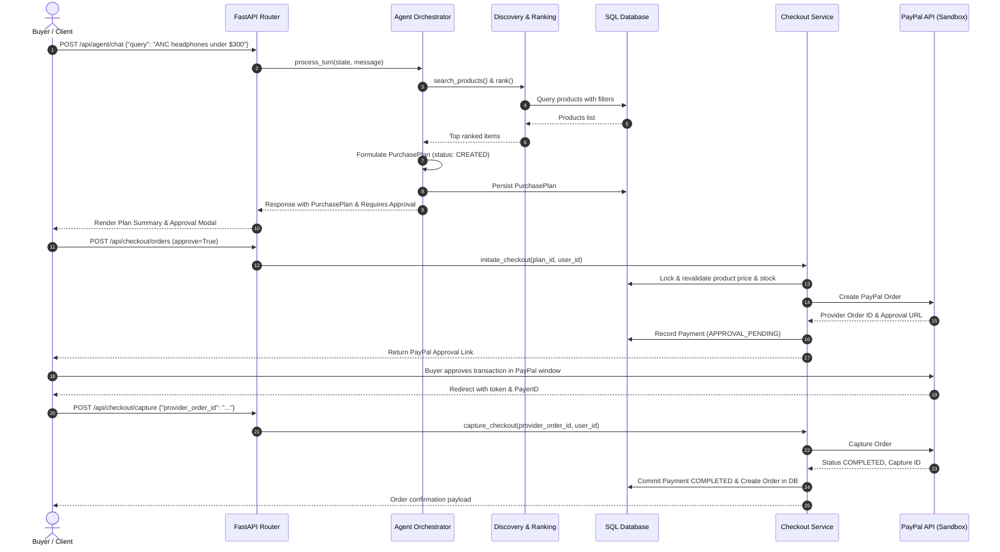

# PayPilot — Architecture Audit & Production Hardening Report

**Role:** Principal Backend Engineer, AI Systems Architect, Application Security Engineer  
**Date:** March 2025  
**Repository:** https://github.com/atleekumaar/paypilot  
**System:** PayPilot — Autonomous AI Commerce Platform

---

## 1. Executive Summary

PayPilot is an AI-powered conversational commerce platform integrating product discovery, multi-turn agent planning, human-in-the-loop purchase approval, and PayPal Sandbox order capture. Over Phases 1 through 4A, basic payment verification, SQLite/PostgreSQL persistence abstractions, and JWT/JWKS authentication models were established.

This audit evaluates the codebase across seven architectural pillars:
1. **Security & Zero-Trust Authorization** (CORS, JWT/JWKS, Cross-User Isolation, Rate Limiting)
2. **Agent Orchestration & Reliability** (State persistence, Concurrency, Budgets, Tool Safety)
3. **Payment State Machine & Integrity** (Lifecycle states, Double-Spend Protection, Outbox pattern, Webhooks, Refunds)
4. **Data Persistence & Migration Health** (SQLAlchemy models, Alembic scripts, Foreign Keys, Indexing)
5. **Recommendation & Ranking Intelligence** (Bayesian adjustments, Multi-attribute ranking, Offline evaluation)
6. **Frontend Architecture & UX Resilience** (API client encapsulation, Error boundaries, State isolation)
7. **Observability & Operational Readiness** (Request IDs, Structured logging, OpenTelemetry integration)

---

## 2. Existing Architecture & Component Responsibilities

### 2.1 Backend Topology
The backend is structured as a modular FastAPI monolith with layered architecture:
```
backend/
├── app/
│   ├── agents/          # AI Orchestrator, LLM Clients, Tool Registry, State Models
│   ├── api/             # FastAPI Routers (agent, catalog, checkout, orders, notifications, health)
│   ├── core/            # Configuration, Security, Auth (JWT/JWKS), Exceptions, Logging
│   ├── db/              # SQLAlchemy session factory, Base model, Database providers
│   ├── models/          # ORM models (Product, PurchasePlan, Payment, Order, AgentSession, etc.)
│   ├── repositories/    # Data access objects with database-first persistence
│   ├── schemas/         # Pydantic request/response schemas and contracts
│   └── services/        # Business logic (CheckoutService, RankingService, DiscoveryService)
├── alembic/             # Version-controlled database migrations
└── tests/               # Pytest suite (unit, integration, security, agent safety)
```

### 2.2 Component Responsibilities & Boundaries

| Component | Responsibility | Boundary & Guarantees |
| :--- | :--- | :--- |
| **`auth.py`** | Decodes & cryptographically verifies JWT tokens via JWKS or HMAC secret. Extracts user claims. | Rejects unverified `X-User-Id` headers when auth is configured; provides safe local demo fallback only when explicitly enabled. |
| **`orchestrator.py`** | Multi-turn dialog manager, LLM prompt formatting, tool invocation, human approval transitions. | Enforces tool schema validation, tool execution permissions, and prevents unauthorized state transitions. |
| **`checkout_service.py`**| Validates cart/plan, verifies prices with catalog, interfaces with PayPal API, captures orders. | Authoritative server-side price calculation; guarantees orders are only captured after explicit user approval. |
| **`ranking_service.py`** | Computes product match scores, relevance, price compliance, and customer satisfaction rank. | Deterministic scoring; safeguards against hallucinated product recommendations. |
| **`session_store.py`** | Loads and commits agent conversation history and memory. | Bridges in-memory ephemeral state with DB persistence (`agent_sessions` table). |

---

## 3. End-to-End Workflow Tracing

### 3.1 Product Discovery to Payment Lifecycle


### 3.2 Post-Purchase Workflow
1. User queries the agent: *"Where is my order #ord_123?"*
2. Agent parses intent and queries `OrderRepository.get_order(order_id)`.
3. Agent checks that `order.user_id == authenticated_user_id`.
4. Agent retrieves shipment tracking information from `ShipmentRepository`.
5. Agent generates natural language status update and estimated delivery date.

---

## 4. Security & Architecture Audit: Verified Defects vs. Debt

| Area | Current Implementation Status | Vulnerability / Defect Level | Remediation Plan |
| :--- | :--- | :--- | :--- |
| **CORS Policy** | `allow_origins=["*"]` with `allow_credentials=True` in `backend/app/main.py`. | **CRITICAL SECURITY FLAW**: Browsers reject wildcard credentials, or if misconfigured, opens CSRF token theft. | Enforce explicit origin whitelist from `settings.ALLOWED_ORIGINS` (`http://localhost:3000`, etc.). Disable wildcard credentials. |
| **Session Ownership** | `orchestrator.py`: `if user_id and state.user_id != user_id: state.user_id = user_id`. | **CRITICAL VULNERABILITY**: Allows active session hijacking if another user ID is supplied. | Delete reassignment. Enforce strict immutability of `session.user_id`. |
| **Session Concurrency** | In-memory session dictionary; DB persistence lacks versioning. | **HIGH**: Lost updates on concurrent user requests or distributed instances. | Add `version` column to `AgentSessionModel` and `AgentState`; implement optimistic concurrency control. |
| **Payment State Machine** | Only 4 states: `CREATED`, `APPROVAL_PENDING`, `COMPLETED`, `FAILED`. Missing `APPROVED`, `CAPTURE_PENDING`, `RECONCILIATION_REQUIRED`. | **HIGH**: Ambiguous state during capture API transit; failure to detect stuck captures. | Expand enum to 8 explicit states. Transition to `CAPTURE_PENDING` before external capture call; mark `RECONCILIATION_REQUIRED` on timeout. |
| **Transactional Outbox** | Order and notification creation executed after capture in best-effort `try/except`. | **HIGH**: If server crashes right after capture, payment is charged but order/notification is never generated. | Introduce `OutboxEventModel` inside the payment commit transaction. |
| **PayPal Webhook** | No PayPal webhook endpoint or signature verification exists. | **MEDIUM**: Dependent exclusively on client redirect for capture confirmation. | Implement `POST /api/payments/paypal/webhook` with asymmetric cert verification and idempotency replay table. |
| **Ranking Rigor** | Uses raw linear rating `(rating / 5.0) * 100` without sample size weighting. | **MEDIUM**: Single 5-star review outranks product with 5,000 reviews at 4.9 stars. | Implement Bayesian shrinkage: $(v \cdot R + m \cdot C) / (v + m)$ with review count weighting and category penalty matrices. |
| **API Client (Frontend)** | `AgentCommerceChat.tsx` hardcodes `http://127.0.0.1:8000/api/agent/chat`. | **MEDIUM**: Breaks when deployed behind custom domain or proxy. | Centralize all frontend fetch calls in `frontend/lib/api.ts` using `NEXT_PUBLIC_API_URL`. |
| **Correlation & Tracing** | Lacks standard `X-Request-ID` and structured request-scoped logs. | **LOW/MEDIUM**: Difficult to debug distributed agent-to-payment traces. | Add Request ID middleware and contextual structured logging. |

---

## 5. Prioritized Remediation Roadmap

1. **Phase 2 — Security & Core Boundaries**:
   - Fix CORS allowed origins and disallow credentialed wildcards.
   - Enforce strict session ownership in `orchestrator.py`.
   - Add pagination (`limit`, `offset`) to `/api/orders` and `/api/notifications`.
   - Add `RequestIDMiddleware` for trace propagation.
2. **Phase 3 — Session & Agent Reliability**:
   - Add `version` to `AgentSessionModel` and `AgentState`.
   - Implement optimistic concurrency in `SessionStore`.
   - Add execution budgets (step counts, timeout safeguards, loop detection).
3. **Phase 4 — Payment Resilience & Outbox**:
   - Expand `PaymentStatus` states.
   - Create `OutboxEventModel` and `WebhookEventModel`.
   - Update `CheckoutService` with transactional outbox and state transitions.
   - Implement PayPal webhook receiver with cryptographic signature verification.
   - Implement refund lifecycle and reconciliation endpoint.
   - Generate Alembic migration.
4. **Phase 5 — Recommendation Intelligence & Offline Evaluation**:
   - Bayesian shrinkage in `ranking_service.py`.
   - Offline evaluation module calculating NDCG@K, Precision@K, Recall@K.
5. **Phase 6 — Frontend Consolidation**:
   - Create `frontend/lib/api.ts` and refactor chat/workspace components.
6. **Phase 7 — Verification & Documentation**:
   - Run backend test suite.
   - Run frontend production build.
   - Author architecture and operations guides (`docs/SYSTEM_ARCHITECTURE.md`, `docs/SECURITY.md`, `docs/PAYMENT_FLOW.md`, `docs/DEPLOYMENT.md`).

