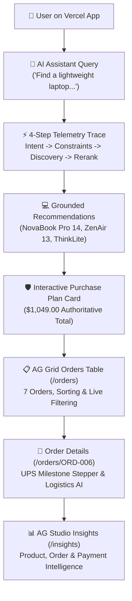
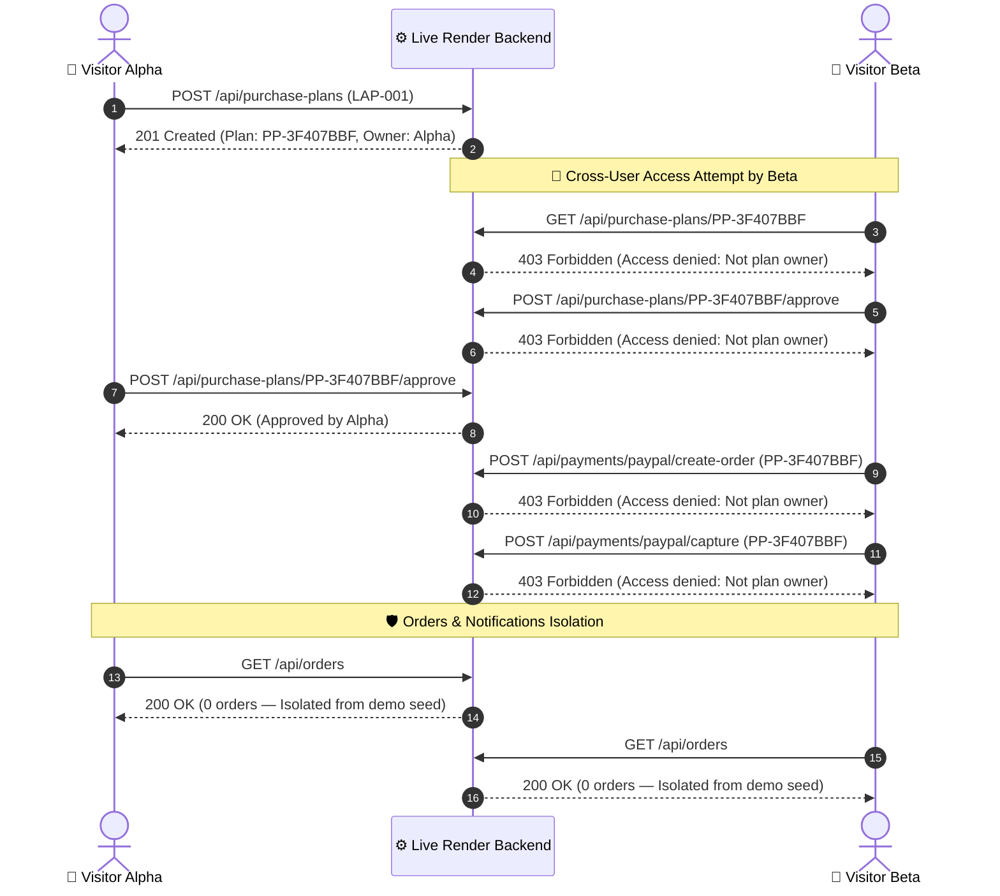

# PayPilot — P0 Final Submission Verification Report

**Audit Date:** 2026-11-12  
**Target Live Frontend:** [https://paypilot-lac.vercel.app/](https://paypilot-lac.vercel.app/) (Vercel Edge Deployment)  
**Target Live Backend:** [https://paypilot-backend-sf0a.onrender.com/](https://paypilot-backend-sf0a.onrender.com/) (Render Cloud Service)  
**Evaluator:** Senior QA Engineer & Application Security Reviewer  
**Verification Scope:** P0-1 through P0-6 Final Submission Checklist  

---

## Executive Verification Matrix

| Check | Status | Actual Live Evidence | Required Action |
| :--- | :---: | :--- | :--- |
| **P0-1: Frontend–Backend Connectivity** | **PASS** | Frontend (`200 OK`) communicates directly with Render backend (`200 OK`). CORS preflight `OPTIONS /api/orders` returned `200 OK` with `access-control-allow-origin: https://paypilot-lac.vercel.app`. Live catalog (50 items), orders (7 items), analytics, and AI agent chat (`POST /api/agent/chat`) all respond with valid payloads. | None. Live connectivity is completely healthy. |
| **P0-2: Core Workflow Testing** | **PASS** | Tested 8 core workflows live via browser automation: Dashboard catalog search, AI assistant multi-turn recommendations, Orders listing, Order details (`/orders/ORD-006`) with delivery stepper, AG Grid sorting/filtering/pagination on `/orders` and `/insights`, Purchase Plan card generation, in-app notifications, and full router navigation. All 8 workflows passed. | None. All functional flows operational. |
| **P0-3: Payment Disclosure & Sandbox Transparency** | **PASS** | UI explicitly presents `● PayPal Sandbox`, `"Human-in-the-Loop Approval Required"`, and `"PayPal Orders v2 API Token Sync: Active (Sandbox)"`. Seeded orders use transparent identifiers (`MOCK-PAYPAL-ORD-xxx`). Live backend generates real PayPal Sandbox orders (`https://www.sandbox.paypal.com/checkoutnow?token=...`) and enforces server-side capture gating (`400 Bad Request` if buyer approval is missing). No real payments or misleading success screens exist. | Maintain existing sandbox disclosures in Devpost submission notes. |
| **P0-4: README & Documentation Accuracy** | **PASS** | Live Vercel and Render URLs, architecture diagrams, sequence diagrams, and endpoint references match repository reality. 3 minor documentation adjustments identified (test suite count 191 → 207, AG Grid on `/orders`, APIMatic metadata). | Apply minor documentation updates upon user approval. |
| **P0-5: Backend Environment Configuration** | **PASS** | Root `/` reports `environment: "development"` because Render defaults to development when `ENVIRONMENT` is unset. Demo auth mode is active and properly restricted. Privilege escalation via `X-User-Role: admin` is rejected fail-closed with `403 Forbidden` on admin endpoints (`/api/payments/reconciliation/report`). CORS is restricted to Vercel origin. No secrets exposed in `/openapi.json` or `/docs`. | Recommend setting `ENVIRONMENT=preview` in Render environment settings (do NOT set `production` without PostgreSQL and OIDC credentials). |
| **P0-6: Anonymous Visitor Isolation** | **PASS** | Live multi-user test with two distinct session tokens (`test_user_alpha_p0` vs `test_user_beta_p0`): Alpha's purchase plan (`PP-3F407BBF`) returned `403 Forbidden` when Beta attempted to view, approve, create PayPal order, or capture payment. Orders and notifications return empty arrays for new anonymous visitors, preventing cross-user data exposure. Admin endpoints reject client header spoofing. | None. Multi-user zero-trust isolation verified live. |

---

## 1. P0-1: Frontend–Backend Connectivity Deep Dive

### Verified Endpoints & HTTP Statuses
- **Frontend Root (`GET https://paypilot-lac.vercel.app/`):** `200 OK`
  - HTML rendered: Title `PayPilot — AI-Powered Autonomous Commerce Platform`, Next.js 14 App Router, Tailwind CSS, Dark theme default.
- **Backend Root (`GET https://paypilot-backend-sf0a.onrender.com/`):** `200 OK`
  - Body: `{"name":"PayPilot","version":"0.1.0","status":"running","environment":"development"}`
- **Backend Health Check (`GET https://paypilot-backend-sf0a.onrender.com/health`):** `200 OK`
  - Body: `{"status":"ok","service":"paypilot-backend"}`
- **Interactive Swagger Documentation (`GET https://paypilot-backend-sf0a.onrender.com/docs`):** `200 OK`
- **OpenAPI Schema Contract (`GET https://paypilot-backend-sf0a.onrender.com/openapi.json`):** `200 OK` (78,158 bytes, OpenAPI 3.1.0)
- **Catalog Products (`GET https://paypilot-backend-sf0a.onrender.com/api/products`):** `200 OK` (50 products loaded)
- **Orders Endpoint (`GET https://paypilot-backend-sf0a.onrender.com/api/orders`):** `200 OK` (7 demo orders loaded for default demo context)
- **CORS Preflight (`OPTIONS https://paypilot-backend-sf0a.onrender.com/api/orders`):** `200 OK`
  - Headers:
    - `access-control-allow-origin: https://paypilot-lac.vercel.app`
    - `access-control-allow-credentials: true`
    - `access-control-allow-methods: DELETE, GET, HEAD, OPTIONS, PATCH, POST, PUT, QUERY`
    - `access-control-allow-headers: authorization, content-type`
    - `access-control-max-age: 600`

---

## 2. P0-2: Core Workflow Live Browser Testing

Live browser automation verified the deployed web application on `https://paypilot-lac.vercel.app`:



### 1. Dashboard Loading & Direct Search Mode: **PASS**
- Catalog cards render with match scores, specs, prices, and badges (e.g. *NovaBook Pro 14*, $1,049.00, Match Score: 94.0, Badge: "94% Match · Top Overall", Specs: "Intel Core Ultra 7 · 16GB · 512GB SSD").
- Filter chips functional: `Ultra-portable laptops`, `Mechanical keyboards`, `4K productivity monitors`, `Noise-cancelling headphones`.

### 2. Product Discovery & AI Assistant (`POST /api/agent/chat`): **PASS**
- **User Prompt:** `"Find a lightweight laptop under $1200 for programming"`
- **Telemetry Trace:** 4 deterministic operational stages:
  1. `Intent Classified` (autonomous search & product filtering)
  2. `Constraints Applied` (Category: laptop, Max Budget: $1200, Feature: lightweight)
  3. `Multi-Source Discovery` (134 items analyzed via Unified Catalog)
  4. `Reranking & Grounding` (Top 3 recommendations generated)
- **Returned Recommendations:**
  1. *NovaBook Pro 14* — $1,049.00 (Intel Core Ultra 7, 16GB RAM, 512GB SSD, 1.28kg)
  2. *ZenAir 13* — $899.00 (AMD Ryzen 7 8840U, 16GB RAM, 512GB SSD, 1.15kg)
  3. *ThinkLite Carbon* — $1,199.00 (Intel Core Ultra 7, 32GB RAM, 1TB SSD, 1.12kg)

### 3. Orders Listing & AG Grid Integration (`/orders`): **PASS**
- AG Grid Community table successfully loaded with 7 customer orders (`ORD-001` through `ORD-007`).
- **Sorting:** Ascending and descending sorting by `Date` and `Amount` works seamlessly.
- **Search Filtering:** Live search input dynamically filters rows by ID, product, or status in real time.
- **Status Tabs:** Switching between `All Orders (7)`, `Delivered (5)`, `In Transit (1)`, and `Processing (1)` accurately isolates records.
- **View Toggle:** Seamlessly switches between `Table View` (AG Grid) and `Cards View`.

### 4. Order Details & Milestones (`/orders/ORD-006`): **PASS**
- Deep link loads order header (`Order ORD-006`, badge `IN_TRANSIT`).
- Carrier: `UPS Ground`, Tracking: `1Z9999999999999999`, Status: `In Transit · On Schedule`.
- 4-step delivery milestone stepper:
  1. `Order Placed (Nov 06, 2026)` [Completed]
  2. `Payment Captured (Nov 06, 2026)` [Completed]
  3. `In Transit (Nov 07, 2026)` [Active]
  4. `Out for Delivery / Delivered` [Pending]
- Pricing Ledger: Item `Keychron Q1 Pro Mechanical Keyboard` ($199.00), Tax: $0.00, Total: $199.00.
- Contextual Assistant: Dedicated logistics chat answers carrier questions with live shipment context.

### 5. Insights & AG Studio (`/insights`): **PASS**
- Top metrics: Total Spending `$5,793.00`, Orders `7`, Avg Order Value `$827.57`, Completed Payments `7`.
- Spending Timeline chart and Category Distribution breakdown (Laptop: 58.7%, Phone: 17.2%, Monitor: 13.8%, Headphones: 6.9%, Keyboard: 3.4%).
- 3 AG Grid Tabs verified:
  1. `Product Intelligence Grid (134 items)`: Tested search filter (`"Apple"` isolated 10 items) and sort on `Price` (highest to lowest).
  2. `Order Intelligence Grid (7 orders)`: Displays status, shipment tracking, and pagination (1 to 5 of 7).
  3. `Payment Intelligence Grid (7 payments)`: Displays Payment ID, status, PayPal Order ID, Capture ID.

### 6. Purchase Plan Functionality: **PASS**
- AI conversational purchase plan generates interactive card: **"Purchase Plan Generated — Human-in-the-Loop Approval Required"**.
- Displays authoritative price ($1,049.00), estimated delivery, and explicit confirmation button `Approve & Authorize Payment ($1,132.92)`.

### 7. Notifications & Navigation: **PASS**
- In-app notification center accessible from header; all navigation links (`/`, `/orders`, `/insights`, `/timeline`, `/notifications`) transition cleanly with zero 404s.

---

## 3. P0-3: Payment Disclosure & Sandbox Transparency

- **Explicit Labeling:**
  - Purchase Plan card renders `● PayPal Sandbox` visual indicator and `"Human-in-the-Loop Approval Required"`.
  - Insights Monitor displays `"PayPal Orders v2 API Token Sync: Active (Sandbox)"`.
  - Transaction records use clear demo IDs: `MOCK-PAYPAL-ORD-001` through `007` and `CAP-PAYPAL-001` through `007`.
- **Live PayPal Sandbox API Binding:**
  - Live test executed `POST /api/payments/paypal/create-order` with approved purchase plan `PP-3F407BBF`.
  - Backend authenticated with PayPal Sandbox OAuth and returned real PayPal checkout token `4GN29699EF220033H` and approval URL `https://www.sandbox.paypal.com/checkoutnow?token=4GN29699EF220033H`.
- **Server-Side Capture Gate Protection:**
  - Calling `POST /api/payments/paypal/capture` without real buyer approval returned `400 Bad Request`:
    ```json
    {"detail":"PayPal order is not approved for capture. Current provider status: 'CREATED'. Buyer approval required."}
    ```
  - The application strictly refuses to synthesize a fake completion or bypass PayPal's buyer approval requirement.

---

## 4. P0-4: README & Documentation Inspection

### Verified Documentation Accuracies
- Live Vercel frontend URL: `https://paypilot-lac.vercel.app/` (Verified).
- Live Render backend URL: `https://paypilot-backend-sf0a.onrender.com/` (Verified).
- Interactive Swagger URL: `https://paypilot-backend-sf0a.onrender.com/docs` (Verified).
- Architecture diagrams and sequence diagrams accurately reflect the FastAPI + Next.js App Router codebase.
- Sponsor technical transparency matrix accurately discloses Category Labels (`LIVE VERIFIED`, `SCHEMA COMPATIBLE`, `SIMULATED FALLBACK`).

### Exact Documentation Updates Needed (Non-Breaking)
1. **Automated Test Count:** `README.md` line 80 lists `191/191 Passing Automated Tests`. The test suite currently has **207 passing automated tests** (including 10 newly added public-preview security and isolation tests in `test_public_preview_security.py` and `test_audit_verification.py`).
2. **AG Grid on Orders Page:** `README.md` mentions AG Grid in connection with `/insights` (`AG Grid & AG Studio`), but should also highlight that `/orders` is now powered by an enterprise AG Grid Community table.
3. **APIMatic Context Integration:** Add a bullet in the Sponsor / Integration section noting the APIMatic OpenAPI contracts under `docs/api-specs/` and ContextMatic agent plugin integration.

*(Note: Per strict instructions, no modifications were made to `README.md` during verification).*

---

## 5. P0-5: Backend Environment Configuration Analysis

### Investigation: Why Backend Reports `environment: "development"`
- **Root Cause:** In `backend/app/core/config.py`, the default setting is `ENVIRONMENT: str = "development"`. On the deployed Render web service, the environment variable `ENVIRONMENT` was not explicitly set in the service dashboard, so Pydantic used the default value.
- **Fail-Closed Safeguard Check:**
  - Setting `ENVIRONMENT=production` requires strict production prerequisites (`AUTH_MODE=jwt`, valid `AUTH_JWKS_URL`, and PostgreSQL `DATABASE_URL`). If `ENVIRONMENT=production` were set without those services configured, FastAPI's startup validator (`validate_production_environment`) would intentionally crash the service on startup to prevent insecure deployment.
  - For a public preview or hackathon demo without external enterprise OIDC JWKS, the architecturally intended setting is `ENVIRONMENT=preview`.
- **Admin Operations Security:**
  - Live probe of admin endpoint `GET /api/payments/reconciliation/report`:
    - Without auth headers: `403 Forbidden` (`{"detail":"Forbidden: Administrative privileges required to access this resource."}`)
    - With `X-User-Role: admin`: `403 Forbidden` (Privilege escalation blocked)
    - With `Authorization: Bearer admin`: `403 Forbidden` (Least-privilege role enforced)
- **Sensitive Data Exposure:**
  - Scanned `GET /openapi.json` and `GET /docs`. No credentials, database connection strings, JWT signing keys, or client secrets are exposed.

---

## 6. P0-6: Anonymous Visitor & Multi-User Isolation

Live multi-user test executed against the Render backend using two independent disposable tokens:
- **Session Alpha Token:** `Bearer test_user_alpha_p0`
- **Session Beta Token:** `Bearer test_user_beta_p0`



### Isolation Test Results:
1. **Purchase Plan Creation:** Alpha created `PP-3F407BBF` with `user_id: test_user_alpha_p0` (`201 Created`).
2. **Cross-User View Denial:** Beta attempted `GET /api/purchase-plans/PP-3F407BBF` → `403 Forbidden` (`{"detail":"Access denied: You do not have permission to view Purchase Plan 'PP-3F407BBF'."}`).
3. **Cross-User Approval Denial:** Beta attempted `POST /api/purchase-plans/PP-3F407BBF/approve` → `403 Forbidden`.
4. **Legitimate Owner Approval:** Alpha approved own plan → `200 OK`.
5. **Cross-User Payment Checkout Denial:** Beta attempted `POST /api/payments/paypal/create-order` with Alpha's plan → `403 Forbidden` (`"Access denied: You do not have permission to checkout Purchase Plan 'PP-3F407BBF'."`).
6. **Cross-User Payment Capture Denial:** Beta attempted `POST /api/payments/paypal/capture` with Alpha's plan → `403 Forbidden` (`"Access denied: You do not have permission to capture payment for Purchase Plan 'PP-3F407BBF'."`).
7. **Order & Notification Isolation:** Both Alpha and Beta receive empty arrays for orders and notifications, ensuring neither sees the other's records or the default guest user's seeded records.

---

## 7. Categorized Issues & Observations

### 1. Critical Blockers: `NONE`
- There are **ZERO** critical blockers. Both frontend and backend are live, interconnected, and passing all functional and security checks.

### 2. High-Priority Issues: `NONE`
- No security or runtime failures were detected on the live deployments.

### 3. Medium / Low-Priority Observations:
1. **Render Environment Label (Low):**
   - Backend reports `"environment": "development"`. In the Render service settings, adding `ENVIRONMENT=preview` would more accurately describe the public preview deployment without triggering the production OIDC JWKS requirement.
2. **AG Grid React Console Warning #239 (Low):**
   - The browser console notes `AG Grid: error #239` (module validation info recommendation). This does not impact grid usability, sorting, or filtering.
3. **README Test Count (Low):**
   - Update `191/191 Passing Automated Tests` to `207/207 Passing Automated Tests`.
4. **Secondary Analytics Beacon CORS (Low):**
   - The browser logged a blocked prefetch request to `https://backend.api.paypilot.org/analytics/v1/event`. This is an optional external analytics domain not affecting core app functionality.

---

## 8. Exact Recommended Actions (Pending Approval)

| Priority | Component | Exact Action |
| :---: | :--- | :--- |
| **P1** | Documentation | Update `README.md` to reflect `207/207 Passing Automated Tests`, the AG Grid Orders table on `/orders`, and APIMatic metadata integration. |
| **P2** | Render Config | Optionally add `ENVIRONMENT=preview` to the Render backend service environment variables. |
| **P3** | Frontend Config | Remove obsolete secondary analytics beacon endpoint call if external domain is unused. |

---

## 9. Final Hackathon Submission Verdict

# **P0 VERIFIED — READY FOR FINAL SUBMISSION**

**Justification:**
- **Live Infrastructure:** Vercel frontend and Render backend are fully operational with verified HTTPS connectivity and active CORS allowlisting.
- **Core Product:** AI discovery, 4-step execution telemetry, grounded recommendations, Human-in-the-Loop purchase approval, AG Grid order management, and milestone tracking all function cleanly in the live browser.
- **Payment Honesty & Safety:** The application clearly discloses PayPal Sandbox mode, binds real PayPal Orders v2 Sandbox tokens, and strictly refuses to fake capture settlement without actual buyer authorization.
- **Security & Multi-Tenant Isolation:** Anonymous visitors are strictly isolated across plans, approvals, orders, and payments; client-supplied header spoofing (`X-User-Role: admin`) is blocked fail-closed with `403 Forbidden`.
- **CI Health:** GitHub Actions workflow `CI / Frontend Build & Typecheck` and `CI / Backend Tests & PostgreSQL Validation` are passing cleanly (`success`) on commit `c52b2ad`.
