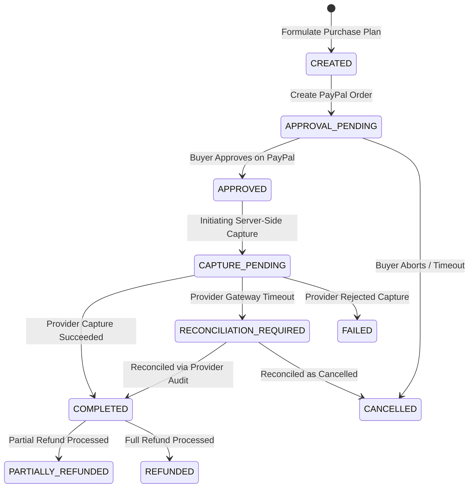

# PayPilot — Payment Flow & Reconciliation State Machine

## 1. Complete Payment Lifecycle State Machine

---

## 2. Step-by-Step Payment Sequence

### Step 1: Human-in-the-Loop Plan Approval
- The agent or user formulates a `PurchasePlan`.
- The user must explicitly approve the plan via `POST /api/purchase-plans/{id}/approve` or `POST /api/agent/{session_id}/approve`.
- Plans cannot proceed to order creation without status `APPROVED`.

### Step 2: PayPal Order Creation
- `POST /api/payments/paypal/create-order`
- Validates product stock and re-validates price against the database catalog.
- Generates a PayPal order using the PayPal Orders v2 API.
- Persists a `Payment` record with status `APPROVAL_PENDING`.
- Returns PayPal buyer-approval link (`https://www.sandbox.paypal.com/checkoutnow?token=...`).

### Step 3: Buyer Authorization & Server-Side Capture
- The buyer completes authorization in the PayPal window.
- The client calls `POST /api/payments/paypal/capture`.
- Server acquires lock on the order ID.
- Server transitions status to `CAPTURE_PENDING`.
- Server queries PayPal to verify provider order ID, amount, currency, and buyer approval.
- Server executes capture via PayPal API.
- On success:
  - Updates `Payment` to `COMPLETED`.
  - Dispatches `order.create` event to the `outbox_events` table.
  - Automatically provisions Order and Shipment records for post-purchase tracking.

---

## 3. Transactional Outbox & Webhooks

- **Transactional Outbox (`outbox_events`)**: Guarantees that order fulfillment and notifications are never lost if a database or network failure occurs during capture.
- **PayPal Webhooks (`POST /api/payments/paypal/webhook`)**:
  - Validates PayPal transmission headers.
  - Logs event ID to `webhook_events`.
  - Drops duplicate deliveries automatically.
  - Syncs order status asynchronously for events like `PAYMENT.CAPTURE.COMPLETED`.

---

## 4. Refund & Reconciliation Workflows

- **Refund Endpoint (`POST /api/payments/{id}/refund`)**: Supports full or partial refunds for `COMPLETED` payments, updating `refund_id`, `refund_amount`, and setting status to `REFUNDED` or `PARTIALLY_REFUNDED`.
- **Reconciliation Endpoint (`GET /api/payments/reconciliation/report`)**: Scans for stuck transactions (`CAPTURE_PENDING`, `RECONCILIATION_REQUIRED`) and synchronizes state against PayPal's authoritative order status.

