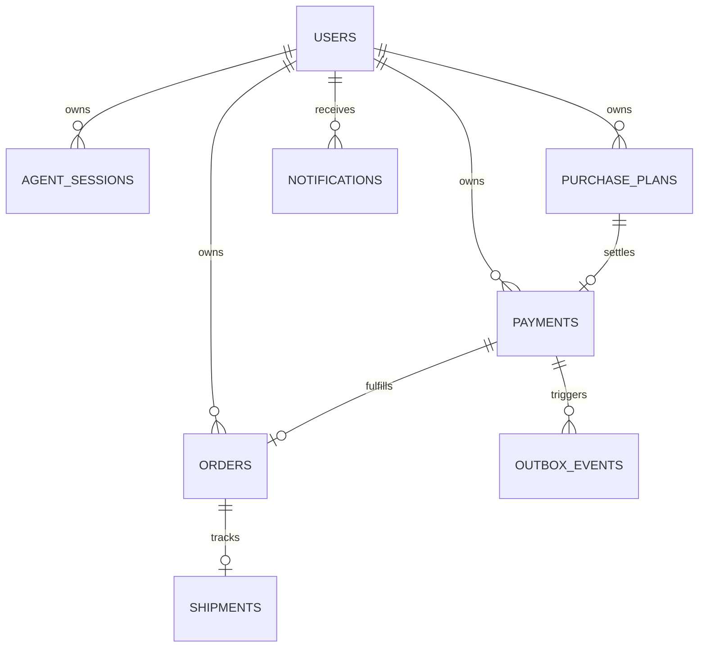

# PayPilot — System Architecture & Component Specification

## 1. High-Level Architecture

PayPilot is an AI-powered conversational commerce platform built with a modular FastAPI backend and a Next.js 14 frontend. It orchestrates product discovery, comparative ranking, human-in-the-loop purchase approvals, and secure payment processing via PayPal Sandbox.

```
┌─────────────────────────────────────────────────────────┐
│                   Next.js 14 Frontend                   │
│   (App Router, Tailwind CSS, Centralized API Client)    │
└────────────────────────────┬────────────────────────────┘
                             │ HTTP / JSON
                             ▼
┌─────────────────────────────────────────────────────────┐
│                     FastAPI Monolith                    │
│                                                         │
│  ┌──────────────────┐  ┌──────────────────────────────┐ │
│  │   API Routers    │  │       Core Middleware        │ │
│  │  - Agent         │  │  - RequestID Middleware      │ │
│  │  - Discovery     │  │  - Whitelisted CORS          │ │
│  │  - Checkout      │  │  - JWT / JWKS Authenticator  │ │
│  │  - Orders        │  └──────────────────────────────┘ │
│  │  - Notifications │                                   │
│  └─────────┬────────┘                                   │
│            │                                            │
│            ▼                                            │
│  ┌───────────────────────────────────────────────────┐  │
│  │                   Domain Services                 │  │
│  │  - AgentOrchestrator (State machine, Memory)      │  │
│  │  - DiscoveryService & RankingService (Bayesian)   │  │
│  │  - CheckoutService (PayPal Orders & Capture)      │  │
│  │  - OrderService & NotificationService             │  │
│  │  - RecommendationEvaluator (NDCG, Precision)      │  │
│  └─────────┬─────────────────────────┬───────────────┘  │
│            │                         │                  │
│            ▼                         ▼                  │
│  ┌──────────────────┐       ┌────────────────────────┐  │
│  │  Tool Registry   │       │  Repository Layer      │  │
│  │  (Schema Checks, │       │  (Database Abstraction)│  │
│  │   Audit Logging) │       └────────────┬───────────┘  │
│  └──────────────────┘                    │              │
└──────────────────────────────────────────┼──────────────┘
                                           │
                                           ▼
                 ┌─────────────────────────────────────────────────┐
                 │          SQLAlchemy 2.0 Persistence             │
                 │   - SQLite (Local Dev / Automated Tests)        │
                 │   - PostgreSQL 16 (Production)                  │
                 │   - Alembic Version-Controlled Migrations       │
                 └─────────────────────────────────────────────────┘
```

---

## 2. Core Subsystems

### 2.1 Autonomous Agent Orchestration
- **AgentOrchestrator**: Coordinates multi-turn dialogue, parses user intent, executes tools from the registered inventory, and enforces deterministic policy rules.
- **AgentState & SessionStore**:authoritative session state persisted in `agent_sessions` with optimistic concurrency locking (`version` column) and immutable ownership validation.
- **Safety Boundaries**: Turn budgets (maximum steps), session expiration (24 hours), prompt-injection heuristic filters, and strict parameter schemas.

### 2.2 Product Discovery & Bayesian Ranking
- **Deterministic Evaluation**: Products matching hard constraints (budget, category, stock) are scored across six weighted dimensions:
  1. Requirement match (35%)
  2. Price fit (25%)
  3. Customer rating (15%) with empirical Bayes shrinkage: $(v \cdot R + m \cdot C) / (v + m)$ where $m=25$ prior reviews and $C=4.2$ mean rating
  4. Delivery speed (10%)
  5. Seller reliability (10%)
  6. Soft preferences (5%)
- **Offline Evaluation Suite**: `RecommendationEvaluator` measures NDCG@K, Precision@K, and Recall@K against benchmark queries.

### 2.3 Payment Lifecycle & Transactional Outbox
- **Checkout State Machine**: 8 explicit states: `CREATED`, `APPROVAL_PENDING`, `APPROVED`, `CAPTURE_PENDING`, `COMPLETED`, `FAILED`, `CANCELLED`, `RECONCILIATION_REQUIRED`.
- **Server-Side Verification**: Authoritative pricing, currency checks, and PayPal buyer-approval verification before capture execution.
- **Transactional Outbox (`outbox_events`)**: Guarantees atomic generation of orders and notifications upon payment completion.
- **Webhook Deduplication (`webhook_events`)**: Prevents duplicate execution on webhook replay.
- **Refunds & Reconciliation**: Full/partial refund endpoints and automated reconciliation for stuck transactions.

---

## 3. Database Schema Entity Relationship



